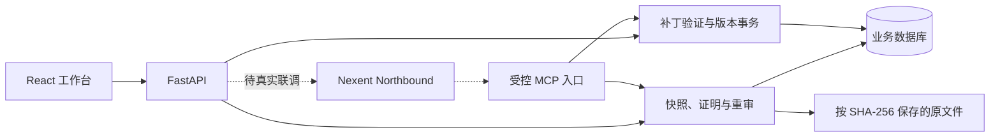

# 五分钟演示

启动 README 中的本地工作台。模拟流程可离线演示。有缓存或能访问公开来源时，先运行 `import-demo` 和 `import-agreement`。知识版本发布演示还需配置本地维护者凭据。

| 时间 | 操作 | 可观测结果 |
| --- | --- | --- |
| 0:00–0:45 | 选择星桥样例公司的滚动观点 | 原披露金额换算为 120,000,000.00 元，结果有证据支持 |
| 0:45–1:30 | 点击证据页码 | 定位到对应资料、解析版本和高亮原文 |
| 1:30–2:30 | 在「变化影响」导入模拟更正，再打开受影响观点 | 更正仅替代收入字段，金额变为 92,000,000.00 元，滚动观点受反驳 |
| 2:30–3:15 | 查看旧结果，再将截止日期设为 2025-03-01 并按历史资料重跑 | 可以读取原快照，也可以从同一公开时间边界建立新运行，固定观点原语义保持 |
| 3:15–4:30 | 验证魅视科技协议补丁，使用维护者凭据发布并回滚 | 候选版本保留备忘录金额用途、协议阶段、成立条件和净额法口径，回滚恢复基线和待处理状态 |
| 4:30–5:00 | 介绍评测和真实 Nexent 联调进度 | 展示局部重审与全量运行的比较，说明当前演示使用 fixture |

## 系统架构

## 来源和材料

- [观典防务原快报与更正公告清单](examples/real-disclosures.json) 记录来源 URL、文件哈希、页码及核验候选。
- [魅视科技协议清单](examples/agreement.json) 记录备忘录金额、阶段和收入确认条件的引用。
- [星桥样例公司模拟资料](examples/simulated-disclosures.json) 包含模拟原披露、更正及正常业务进展。
- [小样本评测报告](eval/REPORT.md) 记录本地实验、错误案例和数据范围。

## 赛题材料复核

华为公开手册列出技术文档、代码和演示视频等材料。北京工业大学公开选拔通知列明赛题三为基于华为 ModelEngine Nexent 打造可进化决策智能体。具体参赛组别的提交窗口、附件模板和评分细则仍需在报名系统核对。[华为 ICT 赛事入口](https://e.huawei.com/cn/talent/ict-academy/#/ict-contest?compId=85132018) · [华为官方手册](https://e-file.huawei.com/marketingcloud/pep/asset/20000001/Material/d669576d54064e609b5b87924aa24be2/M3T1A669N1301556209789747400/%E5%8D%8E%E4%B8%BAICT%E5%A4%A7%E8%B5%9B%E6%89%8B%E5%86%8C2026-2027.pdf) · [北京工业大学赛题通知](https://cs.bjut.edu.cn/info/1076/4323.htm)
