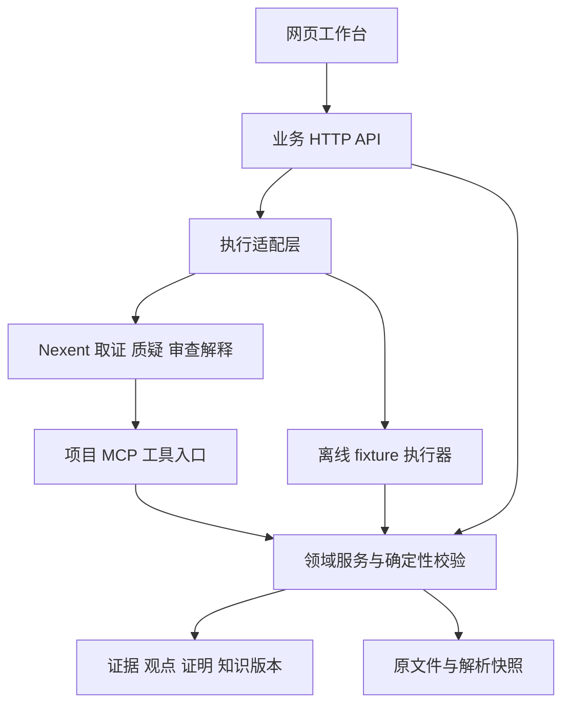

# 明证 FinCourt

## 面向股票投研的可进化证据审查智能体

> 核心问题：我当初看好这家公司的理由，现在还成立吗？

**文档用途：** 本文件是交给 Codex 或其他开发者的产品需求、工程约定、TODO 和验收路线。适用于华为 ICT 大赛创新赛赛题三方向，正式项目名暂定为「基于 Nexent 的股票投研证据审查与投资论点持续重审系统」。

**当前状态：fixture 已贯通公告导入、观点核验、更正重审、历史回放和知识版本更新，并完成小样本评测。** 当前启动方法见 [README](README.md)，实测与阻碍见 [开发记录](DEVELOPMENT.md)。下文保留完整设计和逐项验收目标。

**规格版本：** v0.1，2026-11-26。页面文案使用中文，代码中的标识符使用英文。

---

## 0. 给 Codex 的开工说明

1. 先阅读本文件和仓库已有的 `AGENTS.md`、代码、依赖锁文件，确认当前实现进度。已有代码应增量修改，不覆盖无关工作。
2. 从 **P0 → P1 → P2 → P3 → P4 → P5** 依次开发，优先完成一个贯通前后端和真实数据的最小流程，再扩展功能。
3. 在本文件确定的范围内自主处理常规实现选择；不要因命名、目录划分等小问题反复等待确认。影响业务语义或验收标准的调整写入 `docs/decisions.md`。
4. 每个阶段必须交付可运行结果、相关测试和更新后的 TODO。仅创建空函数、静态页面或写出接口定义，不算阶段完成。
5. 缺少模型或 Nexent 配置时，先完成明确标注的 `fixture` 模式。真实集成保持未完成，不用固定答案或静默降级冒充真实执行。
6. 每次阶段交付说明：实现了什么、运行了什么检查、还有哪些阻碍。检查未运行时说明原因，不写成已经通过。
7. 持续维护本 README。进入下一次开发时，依据未完成任务和实际代码继续，不重新从零搭建。
8. 本项目默认进行本地开发与演示；公开部署、外部推送、购买数据或其他改变外部状态的操作按用户另行指示执行。

### 第一次开发应完成的任务

- [x] 阅读现有工程，记录可复用部分。
- [x] 建立后端、前端、数据库迁移和测试入口。
- [x] 跑通离线演示资料的导入、查询和原文定位。
- [x] 完成一个数值观点的确定性核验。
- [x] 添加一份更正材料，能够查询更正前后的不同结果。
- [x] 建立 Nexent 适配接口，记录真实接入需要验证的配置。

**首个交付的目标：** 用户能在网页上选择一个演示观点，看到支持它的文件页码和计算；加入更正资料后，看到新的核验结果，同时保留旧结果。

---

## 1. 产品目标与范围

### 1.1 项目要解决的问题

股票研究观点往往由若干披露事实、计算和假设组成。资料更正或业务进展变化后，需要重新检查这些依据。本项目把观点保存为可追溯的记录，并在新证据出现时定位和重审受影响部分。

核心流程：

1. 用户输入一个研究观点。
2. 系统拆解可核验的事实、计算、解释和预测。
3. 系统检索支持与反证，检查时间、财务口径和适用条件。
4. 生成有原文依据的审查结果。
5. 新公告进入后，自动定位应重审的旧观点。
6. 遇到现有概念结构无法表达的新业务时，提出经过验证的本体修改。

### 1.2 首发场景

**主要场景：A 股业绩预告、业绩快报及其更正公告。**

扩展场景：重大合同、框架协议、执行条件与收入确认口径。先完成主要场景，再增加扩展场景。

首批拟验证用户为高校金融课程、投资研究社团及小型投研团队。节约查阅和复核时间属于待验证的产品价值，不能预填成已实现效果。

### 1.3 MVP 必须具备

- 文档导入、版本与原文定位。
- 观点拆解和结构化候选抽取。
- 数值、单位、报告期、时间边界校验。
- 支持与反证关系，以及多套证明。
- 更正公告驱动的旧观点重审。
- 审查快照、历史结果查看和历史资料重跑。
- 至少一个真实 Nexent → 自研 MCP 工具的执行流程。
- 至少一个可验证的概念结构扩展案例。
- 数据集、基线比较和可复现的演示。

### 1.4 第一版的范围边界

第一版输出证据状态、待补充信息、变化影响和重审提醒。实时行情、全市场扫描、券商付费研报、完整估值、自动交易、多租户商业平台和模型训练属于后续扩展，不作为首版依赖。

“知识法庭”是交互隐喻。正式结果叫“证据审查结果”，限定于资料范围和适用条件，不使用“司法裁决”等表述。

---

## 2. 用户流程与页面

| 页面 | 主要内容 | 完成判断 |
| --- | --- | --- |
| 观点列表 | 公司、观点、审查日期、当前状态、待重审标记 | 能创建、查阅和筛选观点 |
| 资料库 | 文件来源、披露时间、解析状态、更正关系 | 能打开原文件并定位引用 |
| 观点审查页 | 观点拆解、支持、反证、程序校验和未解决问题 | 每项关键结论可追溯 |
| 变化影响页 | 新旧事实、受影响观点、重审前后差异 | 能说明为何改变或保留观点 |
| 历史记录页 | 保存的审查结果、资料截止时间、知识版本 | 查看旧记录不会重新调用模型 |
| 知识版本页 | 候选补丁、验证结果、维护者确认与发布历史 | 能验证、发布和回退一个补丁 |

前端优先保证可读性：状态除颜色外须有文字；图谱节点可点击查看依据；较复杂的图允许切换为关系列表。首版只显示证据覆盖和缺失项，不显示未经校准的“可靠性百分比”。

### 审查结果至少包含

- 被核验的精确表述，而非整段泛泛总结。
- 截止时点和资料包版本。
- 判断状态、适用条件及判断依据。
- 可定位的原文证据。
- 程序计算的输入、操作和结果。
- 反证或缺失的关键前提。
- 使用的概念、规则及执行配置版本。
- 与上一结果相比改变了什么。

---

## 3. 架构与默认技术选择

采用一个 Python 业务代码库、一个网页前端和一个业务 PostgreSQL 数据库。HTTP API 与 MCP 使用不同入口，复用同一套领域服务。



| 部分 | 默认方案 | 约定 |
| --- | --- | --- |
| 后端 | Python 3.11+、FastAPI、Pydantic | 所有外部输入进行结构校验 |
| 数据库 | PostgreSQL、SQLAlchemy、Alembic | 使用独立业务数据库或 schema，不改 Nexent 内部表 |
| 金额与计算 | Python `Decimal`、受限表达式解释器 | 财务数值序列化为十进制字符串 |
| 依赖图 | 关系表＋内存图遍历 | 首版不依赖独立图数据库 |
| 文档 | PDF 文本解析器＋人工校验入口 | 先支持可提取文本的 PDF；扫描件 OCR 后续增加 |
| 检索 | 结构化过滤＋基础文本检索 | 向量检索和重排按实际误差需要加入 |
| 前端 | React、TypeScript、Vite | 采用团队可维护的组件和图展示库 |
| 智能体 | Nexent | 真实模式必须有实际调用记录 |
| 测试 | pytest＋前端测试＋少量浏览器流程测试 | 聚焦业务边界和关键交互 |
| 环境 | Docker Compose、`uv`、`pnpm` | 固定实际验证的依赖和锁文件 |

以上是工程选择，不声称是相关软件的最新版本。实施时检查官方兼容要求并固定版本；升级不得破坏既有数据格式和验收案例。

### 建议目录

这些路径在开发时创建，不代表当前已经存在。

| 路径 | 职责 |
| --- | --- |
| `backend/pyproject.toml`、`backend/uv.lock` | 后端依赖与锁文件 |
| `backend/src/fincourt/api/` | HTTP 路由、输入输出、错误转换 |
| `backend/src/fincourt/domain/` | 观点、事实、证明、时间语义、补丁定义 |
| `backend/src/fincourt/services/` | 导入、核验、版本差分、重审、发布服务 |
| `backend/src/fincourt/adapters/` | Nexent、fixture、文档解析、存储实现 |
| `backend/src/fincourt/mcp/` | MCP 工具注册与运行上下文约束 |
| `backend/src/fincourt/repositories/` | 业务持久化接口与实现 |
| `backend/migrations/` | 数据库迁移 |
| `frontend/` | 网页工作台 |
| `data/manifests/` | 数据来源、披露日期、文件哈希清单 |
| `data/fixtures/` | 明确标注的模拟资料、预设抽取候选 |
| `data/annotations/` | 人工标注与基准证明图 |
| `tests/unit/`、`tests/integration/`、`tests/e2e/` | 有意义的业务和集成测试 |
| `eval/` | 数据划分、基线、指标、实验配置 |
| `docs/nexent-integration.md` | 已验证版本、接入方法和真实运行记录 |
| `docs/decisions.md`、`docs/data-contract.md` | 技术决策与数据约定 |
| `scripts/`、`Makefile`、`compose.yaml` | 启动、导入、测试和演示入口 |

原始 PDF、临时索引、大型运行结果和密钥默认不进入 Git。可再分发资料是否提交，由来源许可决定；始终保存可复核来源清单。

---

## 4. 领域模型与状态约定

### 4.1 核心对象

| 对象 | 最小字段与用途 |
| --- | --- |
| `Document` | ID、公司、来源 URL、原文件哈希、披露时间或日期、时间精度、采集时间、资料类型、真实或模拟标记 |
| `EvidenceSpan` | 文件 ID、解析版本、1 起始页码、段落或字符范围、原文文本、文本哈希、来源簇 |
| `Fact` | 主体、指标定义、值、单位、报告期、合并范围、币种、审计状态、证据 ID、适用范围 |
| `Claim` | 用户观点原文、结构化表述、观点类型、时点模式、公司、版本、创建时间 |
| `Proof` | 支持或反驳的目标观点、规则 ID、必须同时成立的前提列表、适用条件 |
| `EvidenceSnapshot` | 允许使用的资料及解析版本、截止语义、知识发布版本、创建时刻、清单哈希 |
| `ReviewRun` | 观点版本、资料快照、执行模式、执行配置、运行状态、工具记录、结果 |
| `ReviewResult` | 判断状态、版本状态、依据、缺失项、计算、前后差异、结果版本 |
| `ChangeEvent` | 更正或新增事件、明确变更字段、涉及文件、事件幂等键、受影响范围 |
| `KnowledgeRelease` | 本体、规则、数据投影和检索表示的兼容版本组合，以及对应的数据修订号 |
| `OntologyPatch` | 基准版本、声明式修改、来源、迁移说明、影响清单、验证记录及审批状态 |

SQL 表可适当合并，但领域语义必须保留。不能只用一个 JSON 大字段保存全部内容而没有可查询的版本和依赖关系。

### 4.2 观点类型

- `DISCLOSURE_FACT`：某公司在某份文件中披露了什么。
- `AS_OF_METRIC`：截至指定时点，最新适用披露中的某项指标。
- `CALCULATION`：由明确输入和公式得到的数值或比较结果。
- `INTERPRETATION`：经营解释，需要记录前提和替代解释。
- `FORECAST`：未来预测，记录假设和观察期限，不能因为引用了真实数字就视为已经证实。

观点还须指定时点模式：`FIXED`绑定明确截止日期；`ROLLING`表示持续追踪当前适用资料。收到新公告后，滚动观点建立推进截止时间的新运行，旧运行保留。固定观点不因新公告被改成另一日期的问题；若修复抽取或程序错误，也以同一截止语义另建修订记录并说明原因。

### 4.3 三种状态必须分开

| 维度 | 枚举 | 含义 |
| --- | --- | --- |
| 判断状态 | `SUPPORTED`、`REFUTED`、`DISPUTED`、`INSUFFICIENT` | 有支持、被适用反证否定、争议、证据不足 |
| 结果版本状态 | `CURRENT`、`SUPERSEDED` | 是否为该观点与相同审查上下文下的当前结果 |
| 任务运行状态 | `QUEUED`、`RUNNING`、`SUCCEEDED`、`FAILED`、`CANCELLED` | 技术执行状态 |

运行失败不能被保存为“证据不足”；旧结果被新版本替代不能自动变成“观点错误”。不同截止时点的结果分别保留，不互相覆盖。

### 4.4 财务口径

直接比较前至少检查：公司、指标定义、报告期、合并范围、币种和单位。预告、快报、审计结果等披露阶段与审计状态单独保存。

- 原值和原单位保留，规范化数值使用 `Decimal`。
- 金额、数量、比率等维度不能混算。
- 不同币种没有明确换算依据时，输出无法直接比较。
- 单季度与累计数据不能仅因数字不同就判断冲突。
- 缺失必要口径时请求补证据，不让模型自动填成“通常如此”。

示例：`11,893.72 万元`规范化为`118937200.00 CNY`。这是确定性转换，原值和原单位仍须可查。

---

## 5. 必须遵守的推理与版本规则

### 5.1 原始资料追加保存

原始文件、解析快照、引用位置及已发布审查结果不可被新公告原地覆盖。解析器升级产生新的解析版本，旧引用仍绑定原解析版本。

引用必须验证文件存在、页码或段落存在、引用文本可定位。内部生成的分析报告不能再作为新的独立外部证据循环喂回。

### 5.2 三类时间与两种回放

明确区分：

1. `report_period`：数据属于哪个期间。
2. `published_at`或`published_date`：公众什么时候能够取得该资料。
3. `ingested_at`：本系统什么时候取得资料。

支持两种操作：

- **历史结果查看：** 直接读取已保存的 `ReviewRun` 和 `EvidenceSnapshot`，不调用当前模型、不重新生成解释。
- **历史资料重跑：** 使用当前执行配置，按当时公开资料建立新的快照和运行记录，明确标为重跑。

只有日期精度时，按 `Asia/Shanghai` 的选定日期结束时理解截止范围；保留 `DATE_ONLY` 标记，不能伪造精确发布时间或支持盘中结论。精确时间使用带时区时间戳，存储统一转换为 UTC。

公开资料重跑按公开时间过滤，不能先取最新事实再按报告期筛选。历史更正关系同样受截止时间约束。采集较晚的资料可以用于标注为“事后补采”的历史资料重跑，不能出现在此前已保存的系统快照中。

当前模型可能记得后来发生的事件。证据包限制可以约束引用，不能证明完全消除了模型记忆；最终评估加入公司去标识化和模拟事件对照。

### 5.3 更正只作用于明确范围

“公司曾披露 X”与“当前最新适用披露为 X”是不同观点。

- 更正文件通过明确关系替代对应字段或事实。
- 未被更正的字段继续有效。
- 较新评论不能仅凭日期覆盖原始披露。
- 无法确定更正范围时，产生待确认项，禁止直接废弃整个文件。
- 当前更正和历史回放分别使用各自时间范围内有效的关系。

### 5.4 证明内部 AND，证明之间 OR

同一观点允许多套证明。每套证明的必要前提必须全部满足；不同证明可以独立支撑同一观点。

例如 C 有两套证明：`A AND B`、`D`。B 失效但 D 仍有效时，不能直接否定 C；两套证明都不可用且没有适用反证时，C 为证据不足。

推导依赖必须是无环图。入库和发布前进行循环检查。普通引用或反驳关系可以形成网络，但不能被当作循环自证；首版不实现完整的复杂论证逻辑求解器。

### 5.5 变化传播先标记重审，再形成结果

候选受影响集合至少包含：

1. 明确变化事实的反向依赖闭包。
2. 与新证据在主体、指标、事件、期间上匹配的既有观点。
3. 本体或规则修改明确覆盖的观点。

第2项用于发现此前没有建立依赖边的新反证，不能只遍历旧图而漏掉它。依赖覆盖低或匹配含糊时扩大复核，并记录原因。

对候选观点按推导顺序重审，重新查找有效证明和反证。撤销支持不等于证明其反面；正反证据都有效而无法消解时保留争议。无关结果不重写，幂等重试不产生重复事件或重审任务。

### 5.6 同源转述不重复计权

保存原始来源、转述关系和来源簇。不同网址、媒体或 Agent 不自动等于独立证据。来源关系不明时标记未知，不计作额外独立证明。

### 5.7 计算采用受限表达式

模型只提交结构化候选，不执行其生成的 Python、JavaScript、SQL 或任意模板表达式。

解释器使用预定义的算术、比较和布尔操作，引用已有事实 ID，限制表达式深度和操作数，检查单位并处理除零。禁止 `eval`、`exec`、动态导入和任意函数调用。

拟定表达式示例：

```json
{
  "op": "gt",
  "args": [
    {"fact_id": "example_revenue_fact"},
    {"literal": {"value": "100000000.00", "unit": "CNY"}}
  ]
}
```

原文内容属于待处理数据，不能作为系统指令。遇到资料内要求忽略规则、调用外部工具等文本，保留原文但不执行。

---

## 6. 本体进化与发布流程

### 6.1 什么算本体变化

新增“某公司收入是多少”属于事实更新。新增具有定义、来源及约束的业务类型或关系，才属于概念结构变化。

先用少量业绩公告构建初始结构；扩展到协议材料时，识别原结构不能表达的交易阶段、金额口径或执行条件。不能故意删除单位、时间等基础字段来制造进化演示。

### 6.2 补丁必须包含

- 基准知识发布版本和补丁内容哈希。
- 新增或修改概念的定义、来源及适用范围。
- 声明式类型、关系、字段和约束修改。
- 旧数据迁移规则、无法自动迁移的记录及影响清单。
- 新案例、固定回归测试结果和失败原因。
- 维护者审批记录及实际发布版本。

首版允许的操作集中于新增类型、子类型、关系、字段、约束和标记概念弃用。不得夹带可执行脚本、直接 SQL、权限修改或测试门槛变更；需要新程序能力时形成开发任务。

### 6.3 状态流转

`DRAFT → VALIDATING → READY_FOR_REVIEW → APPROVED → PUBLISHED`

验证失败进入 `VALIDATION_FAILED`，人工拒绝进入 `REJECTED`。已批准补丁若内容、基准版本、测试集或执行代码发生影响验证的变化，必须重新验证。

### 6.4 发布与回滚

1. 在候选版本执行结构检查、迁移预演、新案例和固定回归。
2. 验证结果绑定补丁哈希、基准版本、数据修订号`data_revision`、测试清单及执行配置。
3. 服务端验证维护者身份和实际检查结果，不能信任客户端或模型自报的 `passed: true`。
4. 原子切换本体、规则、数据投影和检索表示的兼容组合。基准版本或数据修订号变化时返回冲突，重新生成投影并验证。MVP中，事实写入和发布共用短时事务锁，避免检查修订号之后又写入新事实的竞争窗口。
5. 回滚恢复一个完整、已验证组合；保留后来新增的原始资料，旧结构无法处理的资料进入待处理状态。

本体发布是维护者 HTTP 接口操作，不作为普通 Agent 可自由调用的 MCP 工具。固定回归集和最终评估集不能由补丁生成器改写；自动生成的测试只能补充已有验证。

---

## 7. Nexent 与 MCP 集成约定

Nexent 官方文档描述了智能体协作、MCP、Skills、知识检索和配置版本等能力，参考[官方功能文档](https://github.com/ModelEngine-Group/nexent/blob/develop/doc/docs/en/getting-started/features.md)与[开发指南](https://github.com/ModelEngine-Group/nexent/blob/develop/doc/docs/en/developer-guide/overview.md)。具体接口与版本在实施时验证。

### 7.1 平台边界

- 取证角色：拆解观点、提取候选事实和依据。
- 质疑角色：找反证、缺失条件、假冲突和同源转述。
- 审查解释角色：根据程序校验和有效证据组织结果。
- 领域服务：执行时间限制、计算、依赖传播、版本和权限校验。

三个角色可共享底层模型，不将其意见一致当成独立事实证据。无需为了角色数量额外增加智能体。

### 7.2 拟建工具

以下名称是本项目接口设计，不是 Nexent 内置 API。

| 工具 | 输入重点 | 输出重点 |
| --- | --- | --- |
| `query_evidence` | 运行上下文、主体、指标或检索词 | 当前资料快照内的证据和定位 |
| `check_claim` | 观点结构、事实 ID、受限表达式 | 口径检查、程序结果、缺失项 |
| `diff_disclosures` | 两个允许访问的文件版本 | 对齐后的变更与更正范围 |
| `find_impacted_claims` | 变更事件和运行上下文 | 依赖及语义匹配产生的重审集合 |
| `propose_patch` | 结构缺口、来源和声明式修改 | 待验证补丁 ID |
| `evaluate_patch` | 候选补丁 ID | 服务端产生的验证记录 |

工具必须复用领域服务，不在 MCP 层重新写一套业务判断。

### 7.3 运行上下文必须由服务端约束

每次审查绑定不可由模型扩大范围的 `snapshot_id`、截止语义、观点版本及知识发布版本。工具端核对上下文，不能只依赖提示词要求“不要看未来资料”。

历史模式下，所有检索、记忆、缓存和工具结果都受资料快照约束；不得开放可绕过快照的通用联网搜索。若平台内置检索不能保证过滤，就通过受控 MCP 工具取证。

### 7.4 两种执行模式

- `fixture`：使用明确标注的预设抽取候选与确定性领域服务，供无密钥开发、回归和离线演示。界面和运行记录须显示该模式。
- `live`：由实际 Nexent 配置驱动模型与工具执行。配置缺失或调用失败时明确报错，不自动回退并伪装成功。

不得根据公司名或测试 ID 硬编码最终判断。fixture 可以提供解析或模型候选的替身，但最终数值校验、版本选择、证明求值和变化传播必须经过实际业务代码。

### 7.5 真实集成验收

- [ ] 锁定实际使用的 Nexent release 或 commit。
- [ ] 验证平台启动、模型配置、MCP 接入和业务 API 的实际调用方式。
- [ ] 在 `docs/nexent-integration.md` 记录经过验证的路径与请求格式，不猜测平台端点。
- [ ] 从网页发起任务，由 Nexent 实际调用自研 MCP，返回可定位证据。
- [ ] 保存脱敏后的工具参数、返回值、执行模式、时间和平台版本。
- [ ] 导出或记录 Agent 与 Skills 配置，使另一环境可以复现。

Nexent 的 Agent 配置回滚不等于业务证据、概念和审查版本回滚。业务版本能力属于本项目实现。

---

## 8. 项目 HTTP API 目标

以下是待实现的项目接口契约，P0 可以先实现同步子集，P2 起使用数据库任务记录和可轮询状态。接口参数与错误信息通过 OpenAPI 明确。

| 方法与路径 | 用途 | 关键限制 |
| --- | --- | --- |
| `GET /health` | 应用和必要依赖状态 | 不泄露密钥 |
| `POST /api/documents` | 上传文件及披露元数据 | 文件限制、哈希、去重、真实性标签 |
| `GET /api/documents/{id}` | 查看文档元数据 | 包含披露和采集时间 |
| `GET /api/documents/{id}/pages/{page}` | 查看页文本或原文定位 | 页码从1开始、绑定解析版本 |
| `POST /api/claims` | 创建观点 | 保留原文和结构化版本 |
| `GET /api/claims/{id}` | 观点、证明及审查历史 | 结果按上下文区分 |
| `POST /api/reviews` | 新审查或历史资料重跑 | 服务端生成并冻结资料快照 |
| `GET /api/reviews/{id}` | 查询运行状态和结果 | 查询本身不重新调用模型 |
| `POST /api/change-events` | 确认新增或更正事件并触发影响分析 | 幂等、范围可查 |
| `GET /api/change-events/{id}/impact` | 查看重审范围和前后差异 | 区分待重审与最终状态 |
| `POST /api/ontology-patches` | 提出候选补丁 | 仅声明式修改 |
| `POST /api/ontology-patches/{id}/validate` | 执行验证 | 结果由服务端写入 |
| `POST /api/ontology-patches/{id}/approve` | 维护者审批 | 校验身份及有效验证记录 |
| `POST /api/ontology-patches/{id}/publish` | 发布知识版本 | 维护者权限、原子性、基准版本检查 |
| `POST /api/knowledge-releases/{id}/rollback` | 回退到已验证组合 | 不删除原始资料和历史记录 |

普通读取或推理使用的凭据不能调用审批、发布和回滚。开发环境可使用分离的维护者 token；测试中使用假凭据，不提交实际密钥。

API 至少区分：输入或口径错误、证据越界、版本冲突、配置缺失和执行失败。客户端展示可理解的错误及任务 ID，后台记录异常细节。

### 拟定审查请求示例

示例 ID 为占位符，实际由系统返回。

```json
{
  "claim_id": "example_claim_id",
  "cutoff": {
    "mode": "PUBLIC_END_OF_DAY",
    "date": "2025-03-01",
    "timezone": "Asia/Shanghai"
  },
  "execution_mode": "fixture",
  "knowledge_release_id": "example_release_id"
}
```

结果返回运行 ID、状态、快照 ID、判断状态、证据位置、程序计算、缺失项、版本和变更理由。模型输出不是未经校验即可持久化的 API 响应。

---

## 9. 首个真实案例与离线资料

### 9.1 可复核的原始文件

观典防务，证券代码688287：

1. [2025-02-28 2024年度业绩快报公告](https://static.cninfo.com.cn/finalpage/2025-02-28/1222663292.PDF)：披露营业总收入11,893.72万元，文件提示数据未经审计。
2. [2025-04-12 业绩预告及业绩快报更正公告](https://static.cninfo.com.cn/finalpage/2025-04-12/1223072781.PDF)：更正为8,998.38万元，同样提示相关数据未经审计。

金额换算期望为118,937,200.00元和89,983,800.00元。以下载文件核对来源页码和文本，记录实际 SHA-256，不在 README 中编造文件哈希。

### 9.2 演示用观点

以下观点由项目为测试构造，不代表真实市场言论：

- C1：公司曾在2月28日快报中披露该营收数值。
- C2：截至3月1日，适用业绩快报中的2024年度营业总收入超过1亿元。
- C3：截至4月13日，当前最新适用披露中的同项收入仍超过1亿元。
- C4：已有材料能够证明该数字是最终审计结果。
- C5：最新适用披露中的2024年度营业总收入超过1亿元，设置为`ROLLING`，持续跟踪。

预期行为：C1作为历史披露事实保留；C2在其指定时点得到支持；C3在更正资料下重新核验；C4不能因公告正式发布就得到支持。最终审查严格绑定各自时点，不能因今天知道更正就改写C2的历史语义。

C5用于演示同一观点的自动重审：原资料下保存一次运行，更正后推进截止日期并生成另一次运行，展示结果差异；C2的固定时点含义保持不变。

本例只验证披露、数值与依赖，不据此实现完整退市规则裁定。更广泛经营解释需要另外记录前提。

### 9.3 离线测试资料

准备明确标注为模拟的一家公司三次披露：原值、更正、与该指标无关的正常更新。另准备同源转载、单位等价、不同报告期和新增反证的边界资料。

模拟值和对象不要伪装成真实上市公司数据。真实与模拟资料都采用相同的数据格式，运行记录标记来源类型。

### 9.4 数据获取边界

首版通过人工选取和上传公开文件开始。来源清单包括URL、文件名、披露时间精度、采集时间、哈希和使用说明。接口批量接入及再分发权限在实施时核实；不要假设公开页面等于无限免费 API。

输入 URL 如在后续开放自动下载，应限制允许的协议、域名、文件大小与重定向目标，拒绝访问本地或内网地址。首版只支持本地上传即可。

---

## 10. 分阶段 TODO 与路线图

任务经验证后勾选，关联测试或演示证据见 [开发记录](DEVELOPMENT.md)。

### P0 基础工程与数据语义

**目标：** 无模型密钥也能验证时间、口径和证据记录。

- [x] P0-01 创建工程、依赖锁文件、格式和基础检查入口。
- [ ] P0-02 建立 PostgreSQL、迁移和本地存储配置。
- [x] P0-03 定义 Document、EvidenceSpan、Fact、Claim、Snapshot 和运行状态，并建立可实际使用的初始KnowledgeRelease清单。
- [x] P0-04 建立真实来源清单与模拟 fixture，区分两种来源。
- [x] P0-05 实现 PDF 文本解析、页码、解析版本与原文定位。
- [x] P0-06 实现 Decimal、单位和报告期校验。
- [x] P0-07 实现按公开时间选择证据及当时有效更正关系。
- [x] P0-08 建立网页基本布局、资料列表和文件查看。
- [x] P0-09 创建 `.env.example`，确认密钥和原始大文件不进入 Git。
- [x] P0-10 完成日期边界、单位等价、不可覆盖和引用校验测试。

**验收：** 导入原公告与更正后，可以在不同截止日期查询到正确版本；旧文件和原引用未改变；相同金额的不同单位得到相同结果。

### P1 单个观点审查闭环

**目标：** 一个观点从输入到证据定位和结果展示完整可用。

- [x] P1-01 实现观点创建和结构化候选格式。
- [x] P1-02 实现 fixture 抽取候选适配器，模式在界面上可见。
- [x] P1-03 实现受限表达式解释器，禁止任意代码执行。
- [x] P1-04 实现四类判断状态与独立版本状态。
- [x] P1-05 实现 Proof、必要前提及多套证明。
- [x] P1-06 实现推导依赖的无环检查。
- [x] P1-07 实现审查 API、快照、引用验证和持久化结果。
- [x] P1-08 完成观点审查页，显示程序输入、结果和缺失项。
- [x] P1-09 实现历史结果查看，读取时不调用模型。
- [x] P1-10 用真实公告核验C1至C4，并建立滚动观点C5及其初始运行，保留出处。

**验收：** 对真实案例的数字和时间条件正确处理；证据不足与运行失败分开；一条证明失效时另一条有效证明仍可支撑观点。

### P2 Nexent 真实集成与运行可观测性

**目标：** 真实智能体通过受控工具执行同一套业务逻辑。

- [ ] P2-01 核实并固定 Nexent 版本，记录实测接入方式。
- [x] P2-02 实现 Nexent 执行适配器与配置检查。
- [x] P2-03 实现query_evidence和check_claim两个核心MCP工具。
- [ ] P2-04 将三个角色配置到实际 Nexent 流程。
- [x] P2-05 建立业绩公告审查Skill。
- [ ] P2-06 对检索、缓存、记忆和工具执行约束资料快照。
- [ ] P2-07 实现运行任务状态、超时、有限重试与取消语义。
- [ ] P2-08 校验模型输出，记录 token 或可获取的调用成本数据。
- [ ] P2-09 完成一次真实网页 → Nexent → MCP → 领域服务 → 结果执行。
- [ ] P2-10 保存脱敏集成日志和配置复现说明。

**验收：** 能查看实际工具调用和来源；错误配置明确报错；历史模式不能通过其他工具取到快照外资料。缺少真实环境时只完成可完成部分，本阶段保持未验收。

### P3 公告变化与局部重审

**目标：** 新资料自动定位需要重新核验的历史观点。

- [x] P3-01 实现主体、指标、口径和文件版本对齐。
- [x] P3-02 实现字段级更正关系和 ChangeEvent。
- [x] P3-03 建立反向依赖索引及拓扑重审。
- [x] P3-04 补充主体、期间、事件匹配，以发现新出现的反证。
- [x] P3-05 重算全部有效证明，区分支持不足与被反驳。
- [x] P3-06 处理来源簇，避免同源转述重复计权。
- [x] P3-07 实现事件与任务幂等，防止重试造成重复更新。
- [x] P3-08 实现变化影响页及可解释的结果差异。
- [x] P3-09 实现历史资料重跑，与历史结果查看明确分开。
- [x] P3-10 比较局部重审和全量重跑的结果、耗时与调用量。
- [x] P3-11 接入diff_disclosures和find_impacted_claims两个MCP工具，以及重审流程Skill。

**验收：** 更正只影响其适用字段；替代证明有效时保留观点；新增反证即使没有旧依赖边也能被发现；无关记录不被无理由重写。

### P4 受控本体进化

**目标：** 实现一个结构缺口发现、补丁、验证和发布的完整过程。

- [x] P4-01 在P0基线清单上补齐候选版本、迁移与发布记录结构。
- [x] P4-02 建立结构缺口候选格式，包含来源和表达失败说明。
- [x] P4-03 实现声明式 OntologyPatch 与允许操作列表。
- [x] P4-04 实现候选版本和迁移预演，保留无法自动迁移项。
- [x] P4-05 增加补丁提议及验证 MCP 工具。
- [x] P4-06 建立固定回归集和新概念案例，隔离最终评估集。
- [x] P4-07 将验证结果绑定补丁、基准、数据修订号、代码和测试版本。
- [x] P4-08 实现服务端维护者审批，拒绝伪造通过状态。
- [x] P4-09 原子发布兼容版本组合，处理并发版本变化和事实导入冲突。
- [x] P4-10 实现完整组合回滚，保留新增原始资料。
- [x] P4-11 用未参与初始构建的协议或新业务材料验证结构扩展。
- [x] P4-12 展示补丁前后差异、适用范围、回归结果和发布记录。

**验收：** 至少一个有资料依据的概念扩展能改善目标案例；回归失败不能发布；回滚后版本一致；事实更新不冒充本体进化。

### P5 数据集 评估与参赛交付

**目标：** 能复现、能比较、能解释错误。

- [ ] P5-01 扩充至约10家公司、80份文档、120条观点的计划规模。
- [x] P5-02 包含更正、协议和正常更新对照，分别标记真实、构造观点与模拟材料。
- [ ] P5-03 两人独立标注观点和证据，保留分歧与复核记录。
- [ ] P5-04 按公司和完整事件链划分开发、验证和最终测试集。
- [ ] P5-05 建立基线与模块移除实验，固定模型和资料可见范围。
- [x] P5-06 输出样本量、错误案例、指标、成本与局限。
- [x] P5-07 完成一次新环境安装与关键案例复现。
- [x] P5-08 准备5分钟演示、系统架构、来源清单和实验报告。
- [ ] P5-09 对照当届官方赛题、材料格式和提交窗口检查。
- [x] P5-10 README 中的启动命令、状态和截图与实际软件一致。

**验收：** 一条入口命令能启动离线演示；真实模式有独立复现步骤；评测报告没有编造数值；部署失败或资料缺失有清晰说明。

### 时间规划参考

按3人团队估算：第1周完成P0和P1的最小子集，第2至3周完成P1/P2，第3至4周完成P3，第4至5周完成P4，第6至8周完成P5和演示完善。此为开发估计，不是赛事截止安排。

---

## 11. 必须通过的关键验收案例

只为真实业务风险编写测试，避免堆积仅重复实现的测试。下列场景应使用小型、可解释的资料和断言。

| 编号 | 场景 | 期望行为 |
| --- | --- | --- |
| T01 | 更正公告尚未公开 | 历史资料包取不到更正文件与更正关系 |
| T02 | 报告期相同但披露日期在未来 | 按公开时间排除，不能按报告期放行 |
| T03 | 只有披露日期，没有时刻 | 明确日粒度，不伪造盘中可知时间 |
| T04 | 1亿元与10,000万元 | 规范化后等值 |
| T05 | 一季度与上半年收入不同 | 不因数字不同直接报矛盾 |
| T06 | 收入更正但其他指标未变 | 仅替代被更正字段，旧披露事实保留 |
| T07 | C由A与B共同支持，同时有独立证明D | B失效、D有效时，C仍可得到支持 |
| T08 | 全部支持失效，但没有有效反证 | 输出证据不足，不直接输出反驳 |
| T09 | 推导依赖形成循环 | 拒绝将循环作为有效证明 |
| T10 | 新反证此前没有旧依赖边 | 通过主体及适用范围匹配进入重审 |
| T11 | 一份公告被十篇文章转述 | 不统计为十一份独立原始证据 |
| T12 | 模型给出不存在的页码或快照外证据ID | 引用校验失败，不发布为有依据结果 |
| T13 | 资料包含忽略规则或执行指令文本 | 作为数据处理，不改变执行权限 |
| T14 | 模型表达式含函数调用或越界操作 | 拒绝执行，无文件或网络副作用 |
| T15 | 同一更正事件提交或重试三次 | 不重复创建事实更新或重审任务 |
| T16 | 查询历史保存结果 | 不调用当前模型、不改变旧结果 |
| T17 | 新补丁通过新案例但破坏旧回归 | 不能进入正式版本 |
| T18 | Agent或客户端自报approved或passed | 服务端不采信，依据自身授权与验证记录 |
| T19 | 补丁验证后基准版本变化 | 发布冲突，要求重新验证 |
| T20 | 迁移失败或发布后回滚 | 在线版本保持一致，原始资料保留 |
| T21 | live模式缺少Nexent配置 | 明确配置错误，不静默伪装为fixture成功 |
| T22 | 真实与fixture执行记录 | 页面与日志能够区分，演示材料不混用 |
| T23 | 迁移验证期间又导入新事实 | 检测数据修订号变化并重新验证，不丢失新增记录 |
| T24 | 固定观点与滚动观点收到同一更正 | 固定观点保持原截止语义；滚动观点建立新运行，旧运行保留 |

---

## 12. 评估方案

### 对照组

1. 普通 RAG 问答。
2. 多角色辩论。
3. 固定概念结构的图谱检索。
4. 本项目的时态依赖重审与补丁机制。

基础模型、资料可见范围和计算预算尽量一致，并明确无法完全一致的部分。局部重审与全量重跑另做成本比较。

### 指标

- 观点状态及关键字段正确性，分类结果报告F1和各类样本量。
- 引用存在且足以支持表述的比例。
- 应重审观点的召回率、重审列表精确率。
- 无有效依据变化的观点中，不合理状态变化的比例。
- 历史执行中越过资料时间边界的情况。
- 本体补丁接受情况、迁移正确性、回归失败及新场景改善。
- 延迟、token或可取得的模型成本、工具次数、人工复核时间。

关闭时间约束、来源合并、依赖传播和本体补丁分别做模块移除实验。最终测试资料不得用于修改补丁或调提示词；同一公司事件链不能跨开发与测试两侧泄漏。

真实文件案例、构造错误观点、纯模拟边界分别报告。小数据集只支持初步比较，不能据此承诺普遍金融有效性。股价涨跌不作为事实或解释真伪的直接标签。

---

## 13. 本地运行与环境变量约定

验证过的 Windows 入口见 [README](README.md)。下表保留计划中的 Make 别名及其目标行为。

| 目标命令 | 待实现的行为 |
| --- | --- |
| `make setup` | 安装锁定依赖并检查必要环境，不写入真实密钥 |
| `make dev` | 启动数据库、业务API和网页开发环境 |
| `make migrate` | 执行显式数据库迁移 |
| `make seed-fixtures` | 幂等导入模拟资料与演示观点 |
| `make import-demo` | 导入已取得并核对来源的真实演示文件 |
| `make demo` | 以fixture模式启动可操作的完整演示 |
| `make test` | 运行确定性核心测试；在线集成明确单独配置 |
| `make test-live` | 显式运行需要真实配置的Nexent集成测试 |
| `make evaluate` | 使用指定数据划分和配置生成评估结果 |

拟定 `.env.example`：

```dotenv
# 下列名称属于FinCourt应用，不代表Nexent官方环境变量。
FINCOURT_MODE=fixture
FINCOURT_DATABASE_URL=
FINCOURT_STORAGE_DIR=./var/storage
FINCOURT_NEXENT_BASE_URL=
FINCOURT_NEXENT_API_TOKEN=
FINCOURT_NEXENT_AGENT_ID=
FINCOURT_ADMIN_TOKEN=
FINCOURT_LOG_LEVEL=INFO
```

Nexent连接字段以实际接入方式为准，确认后同步更新文档。模型服务配置按平台实际要求设置；不要把个人 API key 填入仓库、样例、日志或截图。

默认服务仅用于本地开发，运行日志包含任务 ID、版本、执行模式和工具调用，敏感字段脱敏。测试优先使用离线数据，不应在普通 `make test` 中隐式产生付费调用。

---

## 14. 交付完成标准

- [x] 关键数据流可运行，页面不是固定答案展示。
- [x] 真实公告能够定位到具体文件与原文位置。
- [x] 更正、历史时间、多证明与新反证案例均通过相关检查。
- [ ] Nexent集成有真实执行证据。
- [x] 本体修改有前后差异、来源、验证和发布记录。
- [x] fixture与live、真实与模拟资料均有明确标记。
- [x] 评测结果来自实际运行，数据划分与配置可复核。
- [ ] 失败、超时、配置缺失和证据不足能被正确区分。
- [x] 新环境能够按说明复现关键案例。
- [ ] 官方赛题细则、评分和交付格式已在提交前逐项核对。

本项目的自研贡献重点是时态证据模型、观点依赖重审和受验证的概念更新。平台已有的检索、引用与配置管理不列为自研发明。现有金融智能体已包含多角色协作、程序计算或溯源，创新性通过明确任务与比较实验呈现。

---

## 15. 参考来源与待核实事项

以下链接用于理解赛题方向、平台能力、真实材料和已有工作；版本与许可在实施时再次确认。

- [Nexent 官方仓库](https://github.com/ModelEngine-Group/nexent)
- [Nexent 功能文档](https://github.com/ModelEngine-Group/nexent/blob/develop/doc/docs/en/getting-started/features.md)
- [Nexent 开发指南](https://github.com/ModelEngine-Group/nexent/blob/develop/doc/docs/en/developer-guide/overview.md)
- [TradingAgents 论文](https://arxiv.org/abs/2412.20138)
- [FinRobot 官方项目](https://github.com/AI4Finance-Foundation/FinRobot)
- [多智能体辩论比较研究 ICML 2024](https://proceedings.mlr.press/v235/smit24a.html)
- [W3C PROV-O 来源关系](https://www.w3.org/TR/prov-o/)
- [W3C SHACL 结构验证](https://www.w3.org/TR/shacl/)
- [巨潮资讯公告入口](https://www.cninfo.com.cn/new/index)
- [SEC EDGAR API说明](https://www.sec.gov/search-filings/edgar-application-programming-interfaces)，作为后续美股扩展参考。
- [魅视科技框架协议与备忘录公告](https://static.cninfo.com.cn/finalpage/2026-11-21/1225682693.PDF)，作为条件表达和概念扩展候选材料。
- [北京工业大学创新赛通知](https://cs.bjut.edu.cn/info/1076/4323.htm)，作为赛题三名称的公开佐证。

完整官方评分权重和赛题细则尚需对照报名系统确认。本README不采用未经官方确认的“四项各25%”说法，也不预设任何获奖、准确率或收益结果。

## 16. 开发记录

详见 [开发记录](DEVELOPMENT.md)。
