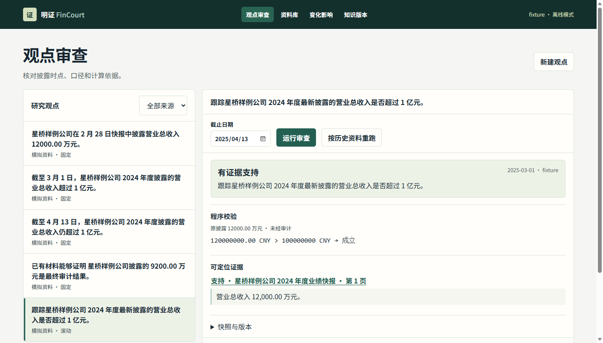

# 明证 FinCourt

面向 A 股投研的证据审查与观点重审工作台。

> 我当初看好这家公司的理由，现在还成立吗？

FinCourt 把研究观点与公告原文、财务口径和计算过程关联起来。用户可以按指定时点审查观点，也可以持续跟踪最新披露。更正公告进入后，系统按更正字段定位受影响的滚动观点，并保存新的审查结果供对比。

**当前状态：fixture 最小流程可运行。** 已验证公告导入、观点审查、更正重审、历史回放和本地知识版本发布回滚。真实 Nexent、PostgreSQL 联调和正式评测仍待验收。[项目规格](Note.md) · [开发记录](DEVELOPMENT.md)

## 首个可运行交付

在「观点审查」选择滚动观点，点击证据跳转到公告原页。打开「变化影响」并导入模拟更正，查看自动重审和证据差异，再从「历史记录」查看更正前的结果。固定观点沿用原截止时点。

真实案例核验观典防务（688287）2024 年度披露的营业总收入是否超过 1 亿元。原快报第 1 页披露 11,893.72 万元，更正公告第 2 页修正为 8,998.38 万元。[业绩快报](https://static.cninfo.com.cn/finalpage/2025-02-28/1222663292.PDF) · [更正公告](https://static.cninfo.com.cn/finalpage/2025-04-12/1223072781.PDF)



## 开发路线

| 阶段                  | 交付目标                                         | 验收要点                                                                       |
| --------------------- | ------------------------------------------------ | ------------------------------------------------------------------------------ |
| P0 基础工程与数据语义 | 搭建前后端、存储、迁移和测试入口，导入并定位公告 | 按公开时间选择有效披露和更正关系，保留原文件与引用，验证金额单位等价           |
| P1 单个观点审查       | 创建观点并生成带证据、计算和快照的审查结果       | 能在网页查看结果与历史，区分证据不足和运行失败，独立的有效替代证明仍可支撑观点 |
| P2 Nexent 集成        | 接入真实智能体、受控 MCP 工具和运行记录          | 网页触发一次真实调用，工具取证受快照约束，配置缺失时明确报错                   |
| P3 公告变化与局部重审 | 按字段更正和观点依赖计算影响范围                 | 发现没有旧依赖的新反证，为滚动观点生成新结果，固定时点和无关结果保持原记录     |
| P4 受控本体进化       | 验证、审批、发布并回滚一项有来源的概念扩展       | 用新业务材料验证表达能力，回归或版本检查失败时阻止发布，回滚后版本一致         |
| P5 评估与参赛交付     | 建立标注数据、基线对照和可复现演示               | 报告实际实验结果，验证新环境安装，核对当届官方提交要求                         |

按 P0 → P5 推进。逐项验收后更新 [任务清单](Note.md#10-分阶段-todo-与路线图) 并追加开发记录。

## 执行模式

- `fixture` 用明确标注的预设抽取候选启动离线演示，由领域服务执行时间过滤、金额换算和判断。真实公告与模拟资料分别标记。
- `live` 由实际配置的 Nexent 和模型通过 MCP 工具取证。缺少配置或调用失败时返回明确错误。真实集成以可复现的真实调用记录验收。

## 本地运行

需要 Python 3.10+、Node.js 20.19+ 和 pnpm 10。以下为 PowerShell 命令。

```powershell
python -m venv .venv
$FinCourtPython = ".\.venv\Scripts\python.exe"
& $FinCourtPython -m pip install -r backend/requirements.lock
pnpm --dir frontend install --frozen-lockfile --store-dir ../var/pnpm-store
& $FinCourtPython scripts/fincourt.py demo
```

打开 [本地工作台](http://127.0.0.1:8000)。离线演示默认使用 `var/` 下的 SQLite 和原文存储。演示导入可重复执行，历史记录保留在数据库中。可在另一终端导入真实案例或运行检查。

```powershell
.\.venv\Scripts\python.exe scripts/fincourt.py import-demo
.\.venv\Scripts\python.exe scripts/fincourt.py import-agreement
.\.venv\Scripts\python.exe scripts/fincourt.py test
.\.venv\Scripts\python.exe eval/run.py --real
```

`import-demo` 和 `import-agreement` 按来源清单下载公开 PDF、校验哈希并保存到本地。测试只读取已有缓存。运行 `eval/run.py` 时省略 `--real` 即可评估纯模拟案例。

协议案例可在「知识版本」验证。审批和本地发布需要在启动服务的进程配置 `FINCOURT_ADMIN_TOKEN`，并在页面输入同一凭据。

- [五分钟演示、系统架构和资料清单](DEMO.md)
- [小样本评测报告](eval/REPORT.md)
- [Nexent 真实联调说明](integrations/nexent/README.md)
- [PostgreSQL 配置](compose.yaml) 的联调环境需设置 `FINCOURT_POSTGRES_PASSWORD` 和 `FINCOURT_DATABASE_URL`，然后运行 `scripts/fincourt.py migrate`。[变量示例](.env.example)
